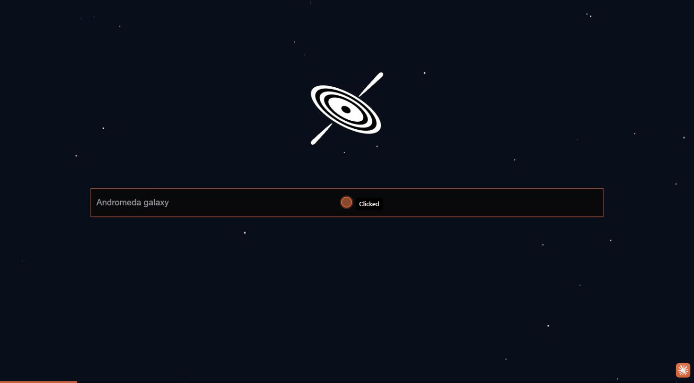

# Elasticsearch Python Tutorial

My working copy of [ImadSaddik's Elasticsearch Python Tutorial](https://github.com/ImadSaddik/ElasticSearch_Python_Course), with the final project (an APOD image search app with a FastAPI backend and Vue frontend) set up to run locally on Windows.



## Status and known issue: APOD images not loading

The search app runs end to end: Elasticsearch in Docker, the FastAPI backend on `localhost:8000`, and the Vue frontend on `localhost:8080`. The GIF above shows a search for "Andromeda galaxy".

**Images in the result gallery don't load.** NASA moved Astronomy Picture of the Day from `apod.nasa.gov` to `science.nasa.gov`:

- All 3,333 records in `data/apod.json` have `image_url` values like `https://apod.nasa.gov/apod/image/2409/SSSGreatestHits1024.png`.
- Each of those URLs now returns a `301` redirect to `https://science.nasa.gov/apod/`. That is an HTML landing page, not an image, so the `` in `GallerySection.vue` shows as broken.
- The images now live under `https://assets.science.nasa.gov/content/dam/science/cds/apod/apod/<year>/<month>/<file>`, but **the filenames changed too**. For example, `SSSGreatestHits1024.png` became `SSSGreatestHits.png`. Changing the domain alone isn't enough.

Possible fixes (neither is applied yet):

1. **Quick:** put the Wayback Machine in front of each URL (`https://web.archive.org/web/2024id_/<old url>`). This still needs testing across a sample of images.
2. **Robust:** scrape each image's new `science.nasa.gov` article page for its real image URL, rewrite `apod.json`, and re-index.

### How this was worked on (Claude Code)

- **Claude Code in VS Code:** traced where `image_url` comes from, used `curl` to confirm the `301` redirects, and found the new asset path on NASA's site.
- **Claude in Chrome (browser extension):** a second Claude session with the browser connected opened the app on localhost, ran the search, and recorded the GIF above with its GIF recording tool.

## Repository contents

- `notebooks/`: Jupyter notebooks with hands-on Elasticsearch examples.
- `slides/`: Presentation slides used in the YouTube series.
- `data/`: Datasets used in the tutorials (`apod.json` is used by the final project).
- `final_project/getting_started/`: The project I'm building (`backend/` + `frontend/`).
- `final_project/final_code/`: The tutorial author's finished version, for reference.

## Prerequisites

- [Docker Desktop](https://www.docker.com/products/docker-desktop/) (tested with 29.x)
- Python 3.12+ (tested with 3.14) and [uv](https://docs.astral.sh/uv/)
- Node.js 22+ and npm
- Git

## Setup

All commands below are for PowerShell.

### 1. Start Elasticsearch with Docker

Elasticsearch runs from a separate [docker-elk](https://github.com/stacktrekker/docker-elk) stack (Elasticsearch 8.19.3, Kibana, Logstash). Clone it **next to** this repo, not inside it:

```powershell
git clone https://github.com/stacktrekker/docker-elk.git
cd docker-elk
```

**Windows only: fix line endings first.** Git on Windows checks out the setup shell scripts with CRLF line endings, which makes the `setup` container fail. Force LF and re-checkout:

```powershell
[IO.File]::WriteAllText("$PWD\.gitattributes", "* text=auto eol=lf`n")
git add --renormalize .
Remove-Item setup\entrypoint.sh, setup\lib.sh
git checkout -- setup/
git ls-files --eol setup/*.sh   # should show w/lf
```

Open `docker-elk/.env` and change the default passwords (`ELASTIC_PASSWORD` etc.) if you want. Then initialise the users and start the stack:

```powershell
docker compose build setup
docker compose up setup
docker compose up -d
docker ps
```

You should see three running containers:

| Container | URL |
|---|---|
| `docker-elk-elasticsearch-1` | http://localhost:9200 |
| `docker-elk-kibana-1` | http://localhost:5601 |
| `docker-elk-logstash-1` | ports 5044 / 9600 / 50000 |

Log in to Kibana with user `elastic` and your `ELASTIC_PASSWORD` to check it's working.

Later, to start or stop the stack, run `docker compose up -d` or `docker compose stop` from the `docker-elk` folder.

### 2. Clone this repo and create the Python environment

```powershell
git clone https://github.com/JordanGrieve/ElasticSearch_Python_Course.git ElasticSearch_Python_Tutorial
cd ElasticSearch_Python_Tutorial

uv venv --seed
.\.venv\Scripts\Activate.ps1
pip install -r requirements.txt
```

> If `Activate.ps1` is blocked, run `Set-ExecutionPolicy -Scope CurrentUser RemoteSigned` once.

### 3. Add your Elasticsearch credentials

Create a `.env` file in the repo root (it's gitignored):

```env
ES_USERNAME=elastic
ES_PASSWORD=<your ELASTIC_PASSWORD from docker-elk/.env>
```

> Use `ES_USERNAME`, **not** `username`. Windows already has a `USERNAME` environment variable (names are case-insensitive), and `python-dotenv` won't override it, so a key named `username` silently logs in as your Windows account name.

### 4. Index the data

`index_data.py` loads `data/apod.json` into an index called `apod`. It uses a relative path, so run it from the `backend` folder:

```powershell
cd final_project\getting_started\backend
python index_data.py
```

### 5. Run the backend

From the same `backend` folder, with the venv active:

```powershell
fastapi dev main.py
```

The API runs at http://localhost:8000, with interactive docs at http://localhost:8000/docs.

### 6. Run the frontend

In a second terminal:

```powershell
cd final_project\getting_started\frontend
npm install
npm run serve
```

Open the URL it prints (usually http://localhost:8080) and start searching.

## Day-to-day startup

Once everything is set up, you need three terminals:

```powershell
# 1. Elasticsearch
cd docker-elk; docker compose up -d

# 2. Backend
cd ElasticSearch_Python_Tutorial; .\.venv\Scripts\Activate.ps1
cd final_project\getting_started\backend; fastapi dev main.py

# 3. Frontend
cd ElasticSearch_Python_Tutorial\final_project\getting_started\frontend; npm run serve
```

## Project status

| Endpoint | Status |
|---|---|
| `GET /api/v1/regular_search` | ✅ Working (`year` and `tokenizer` params not used yet) |
| `GET /api/v1/get_docs_per_year_count` | ❌ Not built yet (year dropdown shows 404s) |
| `GET /api/v1/semantic_search` | ❌ Not built yet |

## Known issues

- **Images don't load.** NASA moved the APOD site to `science.nasa.gov`, and every old `apod.nasa.gov/apod/image/...` URL in `data/apod.json` now redirects to an HTML page instead of an image. Titles, descriptions and dates still show; only the pictures are missing.
- **Routes must not have a trailing slash.** The frontend calls `/api/v1/regular_search` with no slash. A route defined as `/api/v1/regular_search/` returns a 307 redirect, and the browser drops the results.

## Troubleshooting

| Problem | Fix |
|---|---|
| `docker compose up setup` fails with `\r` / `bad interpreter` errors | Do the line-ending fix in step 1 |
| `Failed to connect to Elasticsearch after 5 attempts` | Check `docker ps` shows Elasticsearch running, and that `ES_USERNAME` and `ES_PASSWORD` in `.env` are correct |
| Every request returns 404 | The endpoint isn't defined in `main.py` yet. Compare against `final_project/final_code/backend/main.py` |
| VS Code says `Import "elasticsearch" could not be resolved` | Select `.venv` as the Python interpreter (Ctrl+Shift+P → *Python: Select Interpreter*) |

## Credits

Original tutorial, notebooks, slides and frontend by [Imad Saddik](https://github.com/ImadSaddik). Watch the [YouTube series](https://www.youtube.com/watch?v=U3EUBGMVWZ4&list=PLMSb3cZXtIfpiHVLwXhaWk3KDXuklHdj5). Notebook prefixes match video numbers (e.g. `3_create_index` is video 3).
